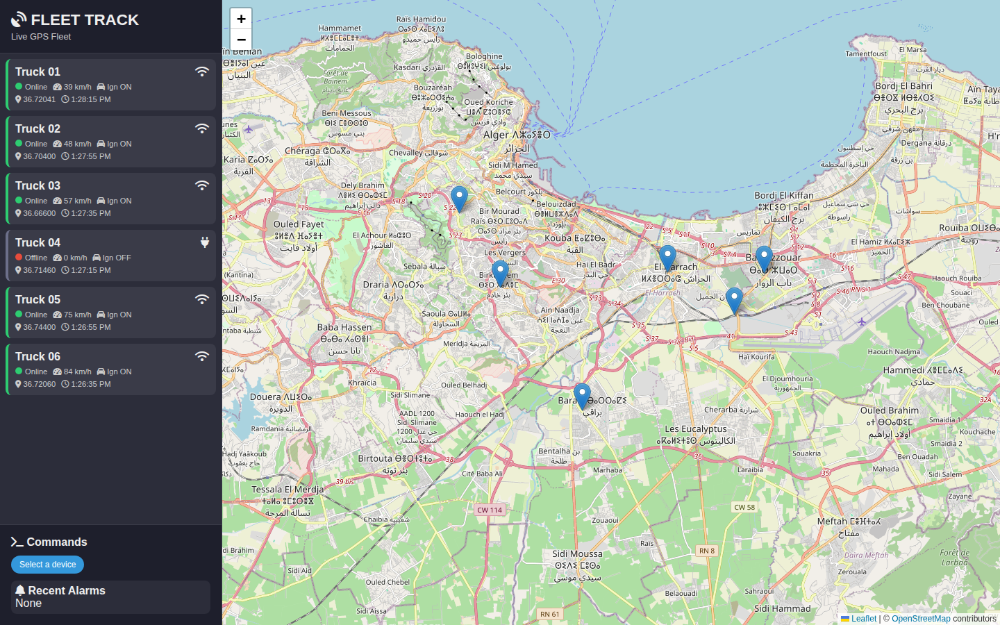
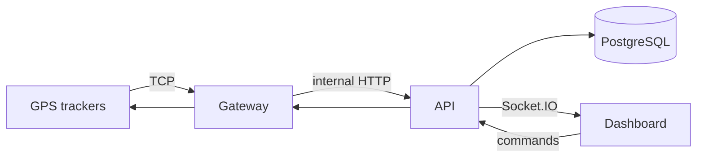
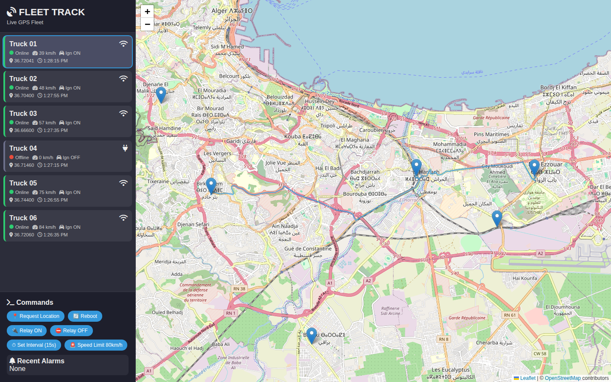

# GPS Fleet Tracking System

Vehicle tracking from raw GPS device traffic to a live map.

A TCP gateway keeps persistent connections with trackers, decodes their binary protocol and forwards positions to an API that stores them, raises events and streams updates to a live dashboard. Commands travel back to the devices.

> **Structure only.** The source code is private. Source files here are intentionally empty so you can see how the project is organized. Commands describe the private codebase.
>
> Company names, logos and data were removed. All data in the screenshots is fictional.



## Features

- Live positions, speed, heading and ignition
- Location history and tracks
- Alarms and acknowledgement
- Remote commands with priorities
- Offline detection

## Applications

| Application | Role |
| --- | --- |
| [TCP gateway](gateway/README.md) | Persistent device connections and protocol decoding |
| [API](api/README.md) | REST, WebSocket and storage |
| [Dashboard](frontend/README.md) | Live map of the fleet |
| [Protocol translator](geo-translator/README.md) | First standalone decoder service |

## Architecture



## Engineering highlights

- Framing and parsing are isolated from sockets, so they can be tested alone
- Gateway and API scale and restart independently
- Indexes designed for device and time queries

## Screenshots

| Fleet dashboard | Device track and commands |
| --- | --- |
|  |  |

The real API and dashboard run on fictional vehicles. The map uses OpenStreetMap tiles (© OpenStreetMap contributors). The React shell is an early skeleton; the working dashboard is a single HTML page.

## Repository layout

```text
gateway/                                Persistent device connections and protocol decoding
api/                                    REST, WebSocket and storage
frontend/                               Live map of the fleet
geo-translator/                         First standalone decoder service
docs/screenshots/
```

Each application has its own README with responsibilities, dependencies, structure and commands.

## Usage

Published for portfolio and presentation purposes. No license is granted for reuse.
