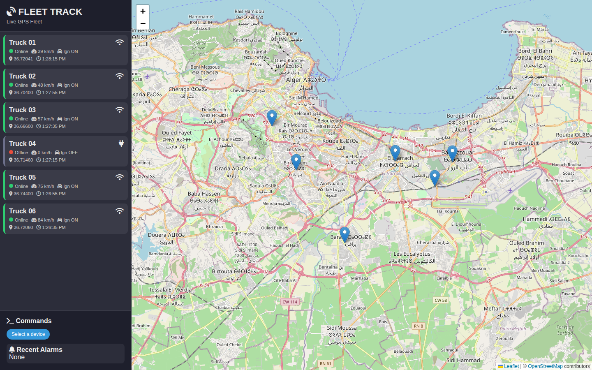
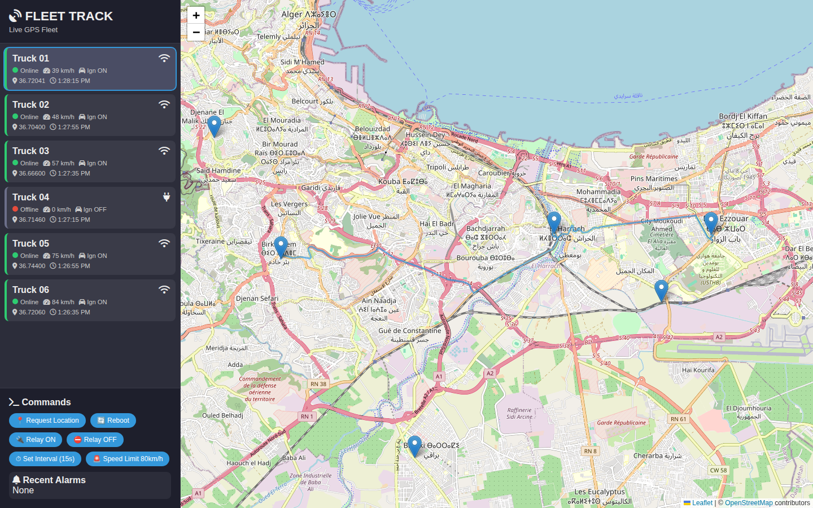

# Dashboard

Live map of the fleet. Part of [GPS Fleet Tracking System](../README.md).

> **Structure only.** The source code is private. Source files here are intentionally empty so you can see how the project is organized. Commands describe the private codebase.

## Responsibilities

- Device list with online state, speed and ignition
- Track history on a Leaflet map
- Commands: locate, reboot, relay, interval, speed limit
- Recent alarms

## Screenshots

| Fleet dashboard | Device track and commands |
| --- | --- |
|  |  |

## Main dependencies

`react`, `react-dom`

## Structure

```text
public/                           2 files
src/                              4 files
src/assets/                       3 files
```

## Commands

```bash
npm install
npm run dev
npm run build
npm run lint
```
